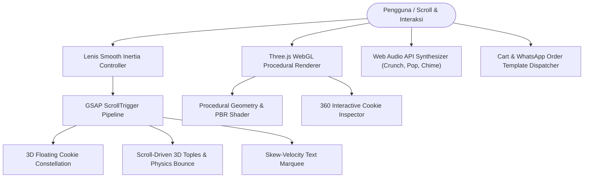

# 🍪 Lumeria — Interactive 3D Artisan Bakery & Cookies Showcase

[](https://github.com/luminariadev/lumeria/actions/workflows/ci.yml)
[](LICENSE)
[](https://vitejs.dev/)
[](https://threejs.org/)
[](https://greensock.com/)
[](https://lenis.darkroom.engineering/)
[](https://www.docker.com/)

**Lumeria** adalah platform web landing page interaktif untuk jenama kue kering artisan rumahan (*Nastar Klasik, Kastengel Edam, Sagu Keju, Putri Salju, Kue Kacang, dan Kuping Gajah*). Menggabungkan **3D procedural modeling** berbasis Three.js WebGL (tanpa dependensi file aset eksternal yang berat), animasi scroll sinematik GSAP ScrollTrigger & Lenis, synthesizer audio prosedural Web Audio API, serta kalkulator pemesanan langsung WhatsApp.

---

## ✨ Fitur & Arsitektur Pengalaman Pengguna

1. **Procedural 3D Cookies Engine (Three.js WebGL)**
   - Model 3D dihasilkan secara prosedural melalui kode shader & geometri parametrik berukuran kilobyte (bebas dependensi file `.glb`/`.gltf` raksasa sehingga load seketika).
   - Detail tekstur khas kue kering:
     - **Nastar Klasik**: Kubah keemasan dengan retakan butter, olesan kuning telur mengkilap (*egg wash gloss*), dan mahkota cengkeh 4 sudut.
     - **Kastengel Edam**: Balok mentega renyah dengan parutan keju Edam Belanda bertabur di atasnya.
     - **Putri Salju**: Bulan sabit berselimut gula halus bubuk salju.
     - **Sagu Keju**: Kelopak bunga spuit 8 lekukan khas santan pandan.

2. **Scroll-Driven 3D Toples Physics**
   - Toples kaca 3D interaktif di mana kue jatuh membal (*bounce physics*) satu per satu seiring scroll pengguna, counter butir terisi secara dinamis, dan tutup merah bersegel terpasang di akhir animasi.

3. **3D Cookie Inspector Modal (Bedah Kue 360°)**
   - Memungkinkan pengguna memutar kue secara interaktif 360°, fitur interaktif *Bite/Gigit* bersuara renyah, dan rincian komposisi bahan baku (*Wijsman butter, keju Edam, nanas segar*).

4. **Synthesizer Audio Prosedural (Web Audio API)**
   - Seluruh efek audio (bunyi gigitan kue *pastry crunch*, letupan pop, denting kaca toples, dan *whoosh*) di-generate secara sintetis tanpa memerlukan file audio eksternal.

5. **Sistem Pemesanan Terintegrasi WhatsApp**
   - Perhitungan subtotal belanja otomatis secara real-time.
   - Pemilihan tanggal pengiriman minimal H+3 (standar pre-order fresh-from-the-oven).
   - Pembuatan template pesan checkout WhatsApp terstruktur rapi ke nomor admin penjual.

---

## 🏛️ Arsitektur Interaktivitas



---

## 📁 Struktur Direktori

```text
lumeria/
├── .github/
│   └── workflows/
│       └── ci.yml               # Automated Vite build CI pipeline
├── public/                      # Static assets & favicon
├── src/
│   ├── components/              # Komponen modular UI & modal 3D inspector
│   ├── styles/                  # Styling tema warm artisan bakery
│   └── main.js                  # Entry point & inisialisasi Three.js engine
├── .dockerignore                # Rule exclude Docker
├── .gitignore                   # Rule exclude Git
├── Dockerfile                   # Multi-stage production Dockerfile (Vite + Nginx)
├── docker-compose.yml           # Orkestras container web lokal & server
├── index.html                   # HTML entry point
├── LICENSE                      # Lisensi MIT
├── nginx.conf                   # Reverse proxy & gzip caching server
├── package.json                 # Manifest dependensi proyek
├── vercel.json                  # Routing konfigurasi Vercel
└── README.md                    # Dokumentasi utama proyek
```

---

## 🚀 Panduan Menjalankan

### Opsi 1: Menggunakan Docker Compose (Direkomendasikan)

Prasyarat: Terinstal Docker dan Docker Compose.

```bash
# 1. Clone repository
git clone https://github.com/luminariadev/lumeria.git
cd lumeria

# 2. Jalankan container
docker compose up -d --build

# 3. Buka di browser
# http://localhost:3000
```

---

### Opsi 2: Menjalankan di Lingkungan Lokal (Node.js)

```bash
# 1. Install dependencies
npm install

# 2. Jalankan development server
npm run dev
# Server aktif di http://localhost:5173

# 3. Build untuk produksi
npm run build

# 4. Preview build produksi
npm run preview
```

---

## 🧪 Pipeline CI/CD

Repository ini dipantau secara berkala melalui **GitHub Actions** (`.github/workflows/ci.yml`):
- Pengecekan dependensi dengan `npm ci`.
- Bundling produksi dengan Vite (`npm run build`).
- Validasi sintaks `docker-compose.yml`.

---

## 📄 Lisensi

Didistribusikan di bawah lisensi **MIT**. Silakan tinjau berkas [`LICENSE`](LICENSE) untuk informasi lebih lanjut.

---

## 👤 Pembuat

**luminariadev**  
- GitHub: [@luminariadev](https://github.com/luminariadev)  
- Email: rizkianuari83@gmail.com
